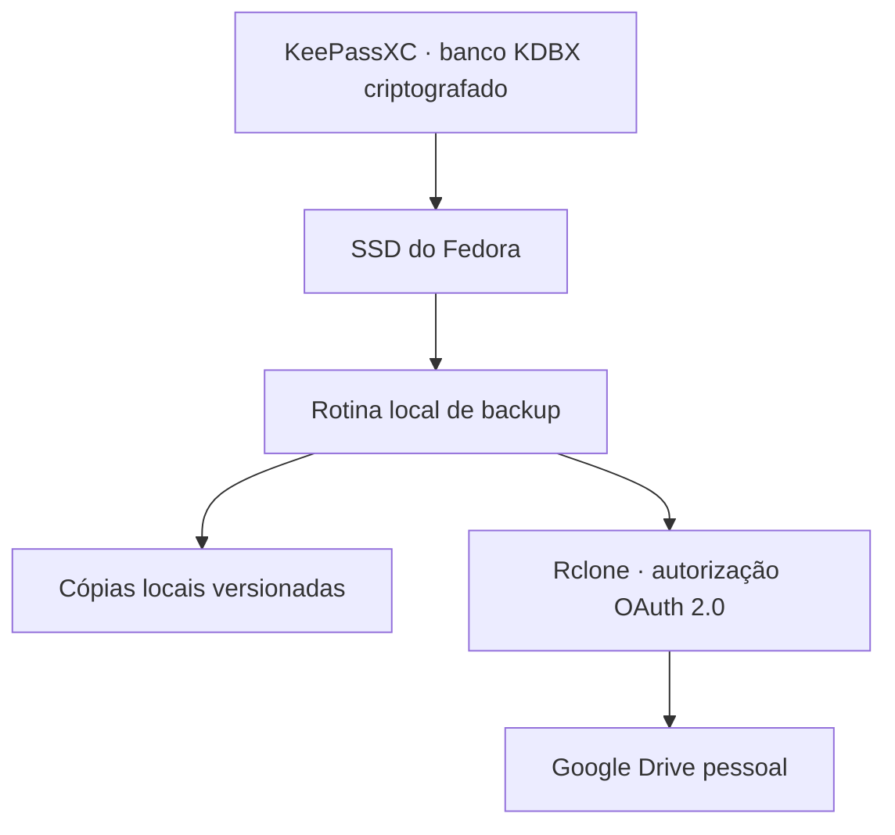

<div align="center">

# KHEPRI BACKUP

### Autorização segura para backups pessoais no Google Drive

**KeePassXC · Rclone · Google Drive · OAuth 2.0**

[](https://pages.github.com/)


**[Página inicial](https://rafafilastro.github.io/khepri-backups-oauth/)** · **[Política de privacidade](https://rafafilastro.github.io/khepri-backups-oauth/privacy.html)**

</div>

---

## Sobre este repositório

Este repositório reúne **as páginas públicas de apresentação e privacidade** da integração pessoal **Khepri Backup**. Elas são utilizadas como referências informativas durante a configuração do consentimento OAuth do Google para uma rotina de backup com **Rclone + Google Drive**.

O objetivo é manter cópias versionadas de um banco de senhas **KeePassXC (`.kdbx`)**, já criptografado, fora do dispositivo principal. O acesso à conta Google é autorizado pelo próprio titular.

> [!IMPORTANT]
> **Este não é o código completo do sistema de backup.** Aqui não estão o banco de senhas, a automação local, tokens de autenticação nem qualquer arquivo de configuração privado. As páginas HTML são apenas informativas.

## Como funciona



O fluxo planejado verifica alterações no arquivo local e mantém versões anteriores para possibilitar recuperação. O Rclone usa a autorização OAuth concedida pelo proprietário para acessar o Drive; o site deste repositório **não acessa o banco de senhas**.

### Princípios adotados

- **Criptografia antes do envio:** o conteúdo do banco é protegido pelo KeePassXC, não pelo site.
- **Controle do titular:** a conta Google autoriza o acesso e pode revogá-lo.
- **Backups versionados:** preservar cópias anteriores reduz o risco de substituir a única versão recuperável.
- **Separação de responsabilidades:** o GitHub Pages hospeda exclusivamente informações públicas; os arquivos de backup e credenciais ficam fora do GitHub.

## Estrutura

```text
khepri-backups-oauth/
├── index.html      # Apresentação do uso pessoal e da integração
├── privacy.html    # Política de privacidade e permissões OAuth
└── README.md       # Documentação deste repositório
```

## Publicação no GitHub Pages

1. Abra **Settings → Pages** deste repositório.
2. Em **Build and deployment**, selecione **Deploy from a branch**.
3. Escolha **main** e **/(root)** e clique em **Save**.
4. Depois da publicação, verifique os endereços da [página inicial](https://rafafilastro.github.io/khepri-backups-oauth/) e da [política de privacidade](https://rafafilastro.github.io/khepri-backups-oauth/privacy.html).

Esses URLs só estarão disponíveis depois que o GitHub Pages concluir a publicação.

## Privacidade e permissões

A integração OAuth pode solicitar o escopo `https://www.googleapis.com/auth/drive`, que concede **acesso amplo ao Google Drive da conta autorizada**, e não apenas a uma pasta. A rotina local deve limitar suas operações ao diretório de backups configurado. O consentimento pode ser revogado nas configurações da Conta Google.

O banco `.kdbx` permanece criptografado. Entretanto, **nomes de arquivo e metadados podem ser visíveis ao provedor de armazenamento**. Consulte a [política de privacidade](privacy.html) para mais detalhes.

> [!CAUTION]
> **Nunca publique neste repositório:** arquivos `.kdbx`, `rclone.conf`, tokens OAuth, Client Secret, chaves SSH, arquivos `.env`, logs que contenham credenciais ou backups de infraestrutura.

## Tecnologias relacionadas

| Tecnologia | Papel no projeto |
| --- | --- |
| **KeePassXC** | Gerenciamento e criptografia do banco de senhas (`.kdbx`) |
| **Fedora Linux** | Sistema que executa o banco local e a automação |
| **Rclone** | Transferência e verificação das cópias no Google Drive |
| **Google Drive API / OAuth 2.0** | Acesso autorizado à conta Google |
| **GitHub Pages** | Hospedagem destas páginas públicas informativas |

## Escopo e situação

Este é um projeto **de uso pessoal**, não um produto comercial nem um serviço de hospedagem de senhas para terceiros. A publicação das páginas **não prova que a rotina automática está ativa ou testada**: essa configuração e os testes de restauração são feitos separadamente, no computador do titular.

---

<div align="center">

**KHEPRI · Tecnologia com foco em segurança, simplicidade e controle**

[GitHub do responsável](https://github.com/RafaFilastro) · [Política de privacidade](privacy.html)

</div>
